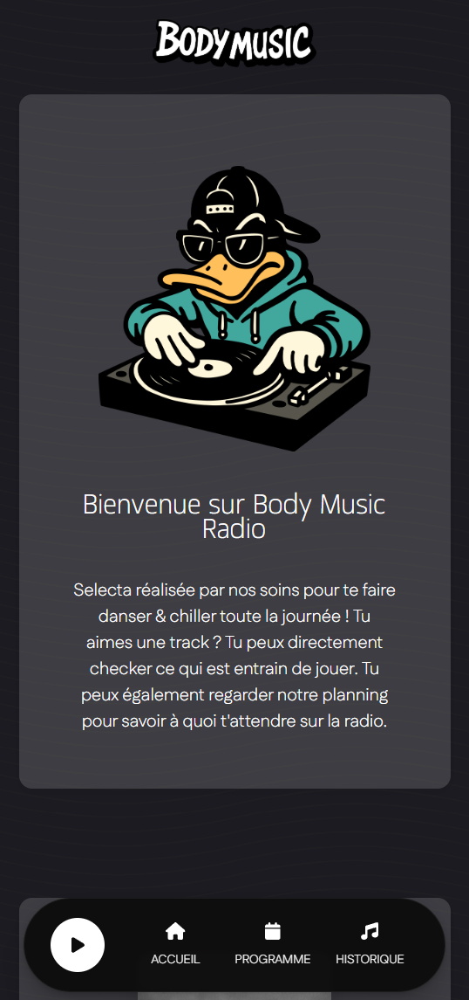
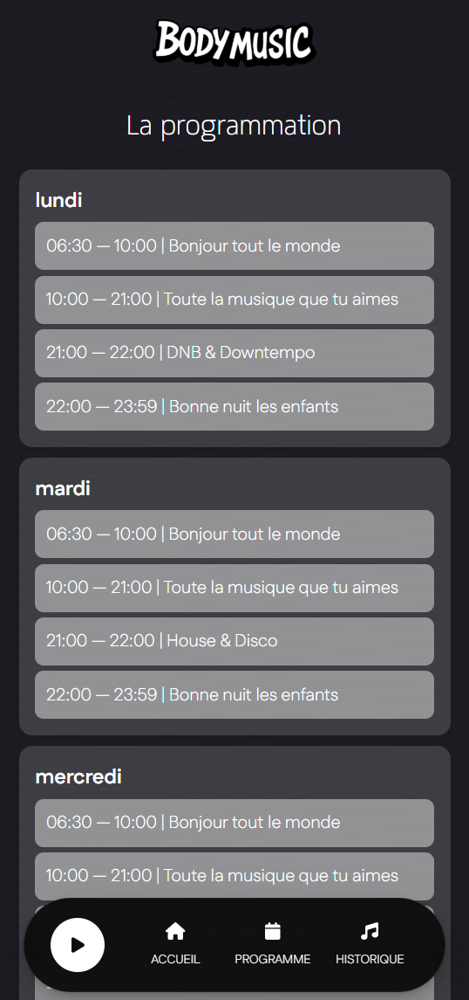
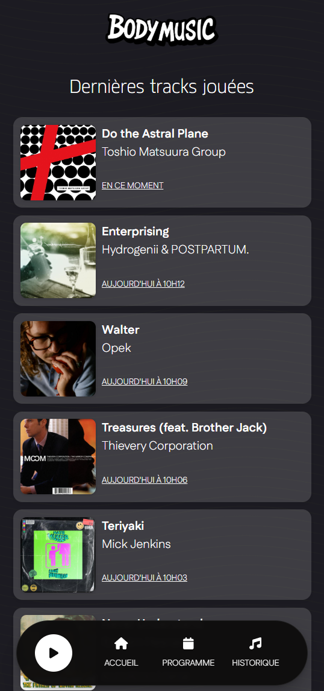

# Body Music Radio

Body Music Radio is a lightweight Vue 3 + Vite web app for streaming our online radio, discovering the current/previously played tracks, browsing our schedule, and showcasing our favorite albums. It's optimized for mobile and ships as a PWA for install-on-device.

  

## Features
- Streaming audio player (Howler) in a sticky header, with Media Session integration (lock-screen controls and live track info)
- "Now playing" in the player and the last 10 tracks on the history page
- Weekly schedule loaded from `public/schedule.json`, with the current show highlighted (Paris time)
- Featured album on the home page, and an albums page with reviews
- PWA: installable, with proper icons and theme

## Tech Stack
- Framework: Vue 3, `vue-router`, Vite
- Audio: `howler`
- UI: Lucide icons, custom CSS
- PWA: `vite-plugin-pwa`
- Tests: Vitest
- Deploy: Vercel (static build + serverless functions in `api/`)

## Data Sources
- Stream: `https://azuracast.niprobin.com/listen/body_music_radio/public.mp3`
- Now playing: `/api/nowplaying`, proxying Icecast's `status-json.xsl`
- History: `/api/history`, proxying an n8n webhook (set `N8N_HISTORY_WEBHOOK_URL` in Vercel)
- Featured album and albums: n8n webhooks (`featured-album`, `liked-albums`) backed by a Google Sheet

## Development
```bash
npm install
npm run dev      # local dev server (the /api functions need `vercel dev`)
npm test         # unit tests for src/lib and the api handlers
npm run build    # production build into dist/
```

## License
No license specified.
